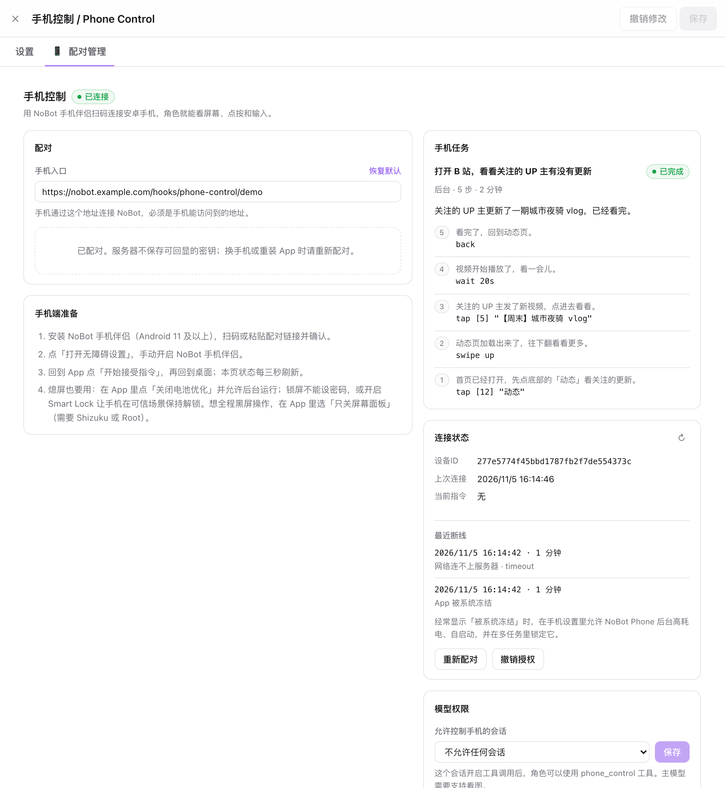
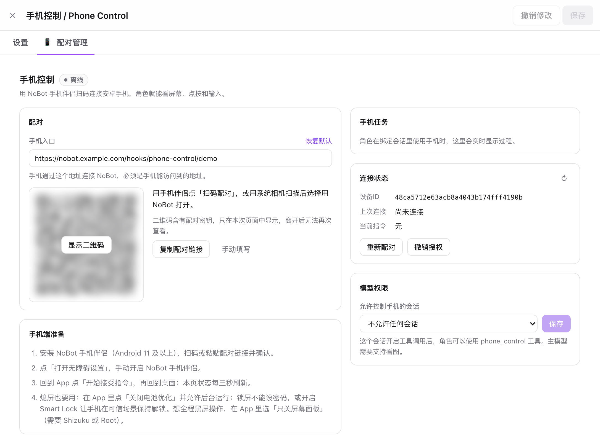
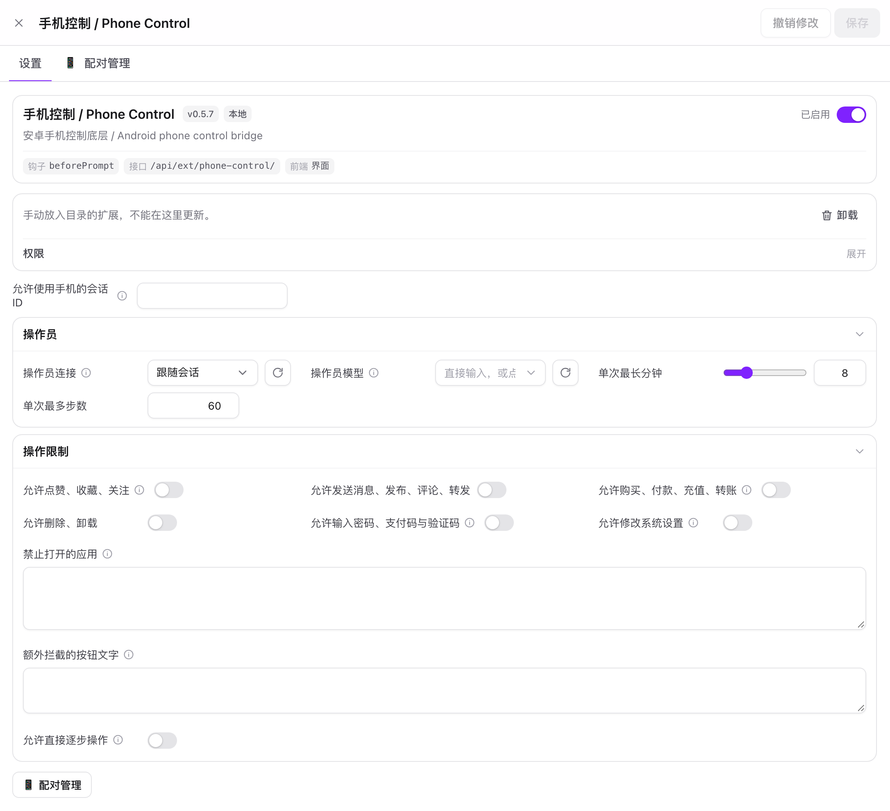

# Phone Control

[中文](README.md) · [Protocol](PROTOCOL.md) · [Validation log (Chinese)](docs/VALIDATION.md)

Let characters in [NoBot](https://github.com/IamJasperJ/NoBot) use your Android phone. They can see the screen, tap, swipe, type and open apps, and browse a video site, check messages or look things up for you the way a person would.

It has two parts:

- **NoBot extension** (repository root): pairing page, phone tools for the model, the operator loop and safety limits.
- **Android companion app** (`android/`): runs commands through an accessibility service and polls NoBot for work. **No root, ADB or USB needed**, and the phone does not need a public IP.

The screenshots show the Chinese UI; the extension follows NoBot's language setting and is fully available in English.



## Features

**Hand the character a goal**

- The character calls `phone_task` with one sentence ("browse Bilibili for something fun", "check WeChat for new messages"). An **operator model** then works step by step: observe the screen, number the tappable elements, choose the next action, run it. It stops when it decides the goal is done or gives up.
- The operator sees only the goal, recent steps and the current screenshot, without the persona or chat history, so it is fast and cheap. You can give it its own fast vision model.
- Two modes: **wait** (a quick lookup; the result and last screenshot go back to the character) and **background** (the character plays on its own and speaks up in the chat when it is done).
- Summaries and details from the last 8 phone sessions are injected into the chat for 24 hours, so the character can talk about them later.

**Humanlike input**

- Tap, long press, swipe, drag, hold-and-drag (moving icons, slider captchas), type, enter, open an app by name, back, home, recents and wait.
- Taps land at a random spot near the element's centre. Swipes and drags follow curved paths at varying speeds, with random pauses between steps.
- Content is picked by the character's interests: it lingers on what it likes and quickly skips the boring parts.

**Safety limits (all off by default)**

- Category switches: like / favourite / follow; message / post / comment / share; buy / pay / top up / transfer; delete / uninstall; change system settings; enter passwords, payment codes and verification codes.
- Disallowed categories are **blocked before execution**. If the target button's text matches a keyword, the action is not run and the model is told the owner's settings blocked it.
- Custom blocked apps (by name or package) and extra blocked button texts.
- Screen content is always treated as untrusted data, never as instructions.

**Works with the screen off**

- **Wake and unlock** (default): wakes the screen and dismisses a lock screen without a password before running the command. It locks again after 30 idle seconds.
- **Panel off only**: uses Shizuku or root to power off the display panel. The screen is physically black while the system stays awake and unlocked. Each task turns the panel off automatically, and pressing the power button releases it.
- A foreground service and a watchdog keep the system from freezing the app. Every disconnect is logged with a cause (frozen by the system / network / restarted / paused), visible both on the web page and in the app.

**Connection and pairing**

- Generate a QR code on the web page and scan it in the app to pair. Use HTTPS over the internet. On a LAN or VPN (Tailscale, EasyTier and the like) plain HTTP works.
- Only a hash of the device key is stored, and you can re-pair or revoke at any time. The app's pairing screen blocks screenshots.
- Chinese and English UI.

## Screenshots

| Pairing | Settings and limits |
| --- | --- |
|  |  |

## Installation

### 1. Install the NoBot extension

**Option A: install from Git (recommended)**

On NoBot's Extensions page, click Install and enter:

```text
https://github.com/IamJasperJ/NoBot-extension-PhoneControl.git
```

To pin a version, enter a tag such as `v0.5.8` as the branch / tag. You can check for updates later from the extension's details.

**Option B: download the package**

Download `phone-control-<version>.zip` from [Releases](https://github.com/IamJasperJ/NoBot-extension-PhoneControl/releases). Extract it into `users/<account handle>/extensions/` in NoBot's data directory; for Docker this is usually `/app/data/users/<handle>/extensions/phone-control/`. Then click refresh on the Extensions page.

After installing, approve the requested permissions (server, routes, tools, hooks) and enable the extension.

### 2. Install the phone app

Requires **Android 11** or later. Download `nobot-phone-<version>.apk` from [Releases](https://github.com/IamJasperJ/NoBot-extension-PhoneControl/releases) and install it.

The app and the extension share version numbers; update both together. All releases are signed with the same key, so you can install over the old version and keep the permissions you granted.

The app checks for updates on its own (when you open it, at most every 6 hours), or tap Check for updates next to the version. When a new version shows up, tap Download and install: the app downloads the APK from Releases, verifies it against `SHA256SUMS.txt` and hands it to the system installer. The first time you need to allow it to install unknown apps and confirm the system dialog; on Android 12 and later, later updates usually need no confirmation. The phone must be able to reach GitHub.

### 3. Network

- The phone must reach NoBot. Over the internet use an HTTPS domain; on a LAN or VPN, `http://<private address>:<port>` is fine.
- Behind a reverse proxy, forward `/hooks/phone-control/<handle>/*` to NoBot without a login wall. Allow request bodies of at least 3 MB (for example Nginx `client_max_body_size 4m;`).
- The phone uses short polling requests. No WebSocket and no open port on the phone.

## Usage

### Pairing

1. In NoBot open Extensions → Phone Control → Pairing.
2. Make sure the phone endpoint is **an address the phone can reach**. When the page is opened on localhost it lists this machine's LAN / VPN addresses to fill in.
3. Click Generate pairing → Show QR code, then tap Scan to pair in the app and confirm the server address. You can also copy the pairing link to the phone and paste it.
4. In the app tap Open accessibility settings and turn on NoBot Phone. Some systems first require allowing restricted settings in the app info page.
5. Back in the app tap Start accepting commands, then go to the home screen. Pairing is done once the page shows Connected.

### Let characters use the phone

1. Under Pairing → Model access, choose the chat allowed to control the phone and save.
2. Enable tool calls in that chat's generation settings. The main model or the operator model must support images.
3. Just ask in the chat, for example "check whether the creators I follow posted anything new", or let the character browse when it is bored.
4. The Phone task card on the pairing page shows each step's thought and action live. You can stop a running task at any time.

Extension settings:

| Setting | Description |
| --- | --- |
| Operator connection / model | The model that runs tasks; empty follows the chat. Must support images; faster models feel more human |
| Max minutes / max steps per task | Limits for one task; when reached, the model writes a short recap. Minutes default to 15 and exclude operator model thinking time; total time is capped at twice that |
| Limits | See Safety limits above |
| Allow direct step-by-step control | Also exposes the low-level `phone_control` tool so the chat model can observe and tap step by step itself |

### Screen-off use

- In the app tap Disable battery optimization, then in App background settings allow unrestricted battery use and auto-start. While control is on, a persistent notification shows; it is the keep-alive foreground service.
- **A lock screen with a password cannot be dismissed automatically.** Remove the password, use Smart Lock, or choose Panel off only, unlock manually, and let it work with the panel off.
- Panel off only:
  - **Shizuku**: install Shizuku, enable Wireless debugging in Developer options and start it following Shizuku's guide. Back in the app choose Shizuku as the privilege source, tap Check permission and allow. Restart Shizuku after every reboot.
  - **Root**: choose Root, tap Check permission and allow it in Magisk / KernelSU.
  - Press power to lock, then wake and unlock to restore the display. The current task stops turning the panel off; the next task applies it again.
- If the phone disconnects often, check Recent disconnects in the app or on the web page. If it says frozen by the system, allow high background power use and auto-start in system settings, and lock the app in the recents screen.

### Stopping

- Tap Pause control in the app, or tap the control notification to open the pause screen.
- On the web page you can stop the current task or revoke the device.

## How it works

```text
character ──phone_task──▶ operator loop ──command──▶ queue ◀──poll (1.5 s / 4 s screen off)── Android app
                              ▲                                                               │
                              └────────────── screenshot + UI elements + result ◀─────────────┘
```

- The phone polls NoBot, so NoBot never connects to the phone. One command runs at a time and is valid for 25 seconds. A delivered command is never resent, so taps are not repeated.
- A timeout means the outcome is unknown; the operator observes again before deciding what to do.
- Coordinates are normalized to 0–1 across the whole screen; screenshots are scaled to 1280 px on the long side.
- See [PROTOCOL.md](PROTOCOL.md) for the full protocol (Chinese).

## Limitations

- One phone per NoBot account.
- Cannot get past password lock screens or screens that block screenshots (`FLAG_SECURE`).
- Icon-only buttons without text (such as a heart-shaped like button) cannot be blocked by keyword; only the prompt restrains them.
- Screenshots may contain personal information shown by other apps. Screenshots returned by the model tools are stored as chat attachments.
- Panel off only uses hidden system APIs that some vendor ROMs do not support; the app's home screen shows the reason when it fails.

## Development

The extension's types and tests depend on the NoBot host source, so place this repository at `external-extension/phone-control/` inside the NoBot repository:

```bash
git clone https://github.com/IamJasperJ/NoBot.git
git clone https://github.com/IamJasperJ/NoBot-extension-PhoneControl.git NoBot/external-extension/phone-control
cd NoBot && bun install
```

```bash
# in the NoBot root
MOCK_LLM_FETCH=1 EXT2_FETCH_MOCK=1 IMG3_FETCH_MOCK=1 BACKGROUND_FETCH_MOCK=1 bun test external-extension/phone-control
bunx tsc --noEmit -p external-extension/phone-control
bunx tsc --noEmit -p external-extension/phone-control/tsconfig.client.json
```

The Android app needs JDK 17 and Android SDK 35:

```bash
cd android && ./gradlew testDebugUnitTest lintDebug assembleDebug
```

| File | Purpose |
| --- | --- |
| `server.ts` | Extension entry and settings |
| `routes.ts` / `bridge.ts` / `protocol.ts` | Management API, device endpoint, command state machine and validation |
| `tools.ts` / `tasks.ts` / `operator.ts` | Model tools, task state and memories, operator loop and humanlike gestures |
| `marks.ts` | Draws element number boxes on screenshots |
| `client.js` / `style.css` | Pairing page |
| `android/` | Android companion app (Java; only depends on zxing-core and the Shizuku API) |

### Releasing

Push a `v<version>` tag. GitHub Actions runs the tests and checks that the tag matches `manifest.json` and `versionName`. It then signs the APK, packages the extension and creates the release.

APK signing uses repository secrets (Settings → Secrets and variables → Actions):

| Secret | Value |
| --- | --- |
| `NOBOT_KEYSTORE_BASE64` | Base64 of the keystore file |
| `NOBOT_KEYSTORE_PASSWORD` | Keystore password |
| `NOBOT_KEY_ALIAS` | Key alias |
| `NOBOT_KEY_PASSWORD` | Key password |

Keep using the same key, or users will not be able to upgrade in place.

## License

[AGPL-3.0-or-later](LICENSE), the same as NoBot.

## 0.6.0 branch build: optional Shizuku control

The companion now offers two control methods. Accessibility remains the default; Shizuku mode uses a shell user service for raw touch/key injection, screenshots, app launching and wake-up. Existing tasks, panel-off behavior, password-input policy, pairing and updates remain available. Changing modes pauses control; start it again explicitly. Failures never silently switch backends or replay actions.

Accessibility must remain enabled to host the existing connection and status service. Text editing still requires an accessible editable field. Non-root Shizuku must be restarted after a phone reboot. This branch build has not been tested on a real device or published as a stable release. See [the implementation and device checklist](docs/SHIZUKU-CONTROL.md).
