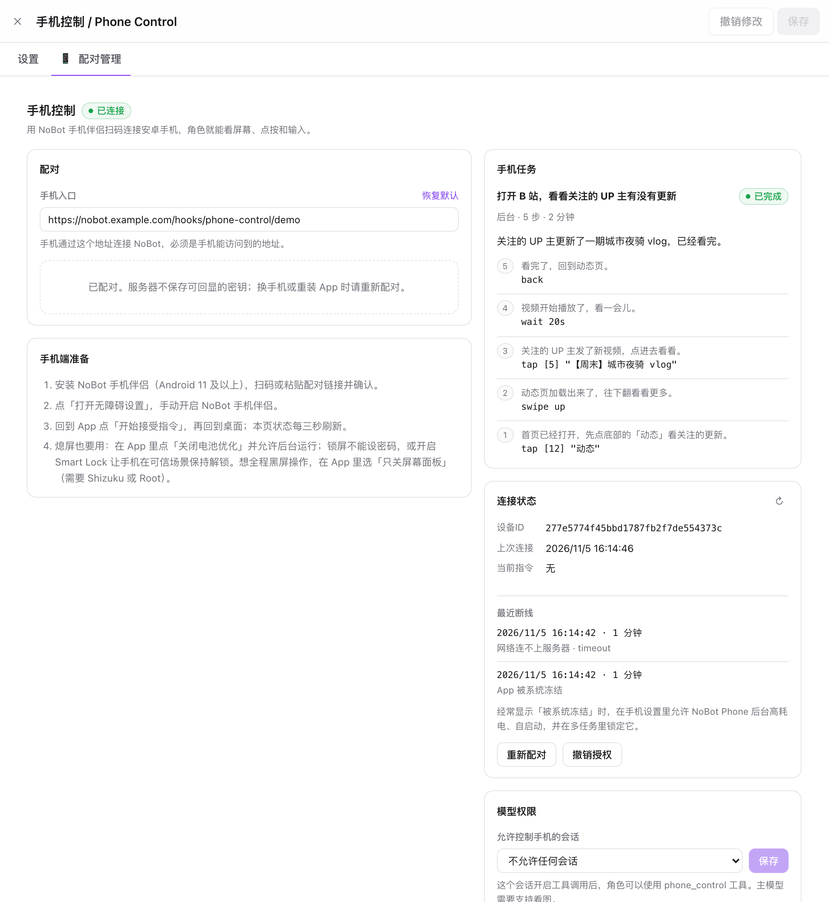
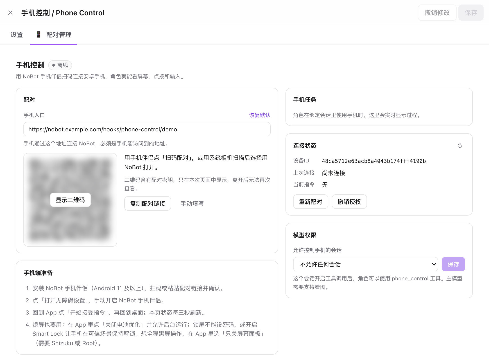
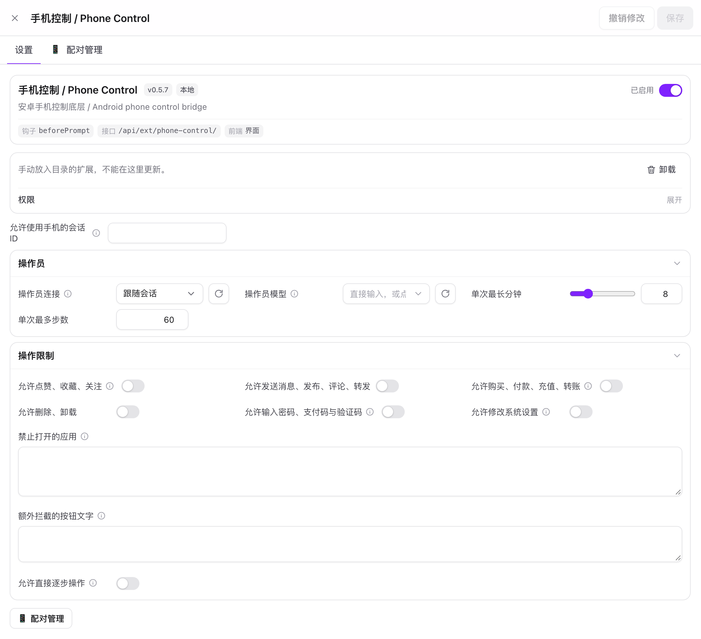

# 手机控制 / Phone Control

[English](README.en.md) · [通信协议](PROTOCOL.md) · [验收记录](docs/VALIDATION.md)

让 [NoBot](https://github.com/IamJasperJ/NoBot) 里的角色用上你的安卓手机：看屏幕、点按、滑动、输入、打开应用，像真人一样刷 B 站、看消息、帮你查东西。

由两部分组成：

- **NoBot 扩展**（本仓库根目录）：配对管理页面、给模型用的手机工具、操作员循环和安全限制。
- **安卓伴侣 App**（`android/`）：基于无障碍服务执行指令，主动轮询连接 NoBot。**不需要 Root、ADB 或 USB**，手机也不需要公网 IP。



## 功能

**一句话交给角色**

- 角色只要调用 `phone_task`，说一句目标（「刷会儿 B 站找点好玩的」「看看微信有没有新消息」），由**操作员模型**一步步完成：观察屏幕 → 给可点元素画编号框 → 决定下一步动作 → 执行，直到它判断完成或放弃。
- 操作员只看目标、最近的操作记录和当前截图，不带人设和聊天历史，快且省。可以单独指定一个看图快的模型。
- 两种模式：**等结果**（快速查一下，跑完把结果和截图交给角色）和**后台**（角色自己去玩，结束后主动在会话里说一句）。
- 最近 8 次手机使用的总结和细节会在 24 小时内注入会话，角色之后聊天能接上。

**像真人一样操作**

- 点按、长按、滑动、拖动、按住拖（拖图标、拼图验证）、输入、回车、按名字打开应用、返回、主页、最近任务、等待。
- 点按落在元素内偏中心的随机位置；滑动和拖动走带弧度的曲线、速度随机；两步之间随机停顿。
- 按角色的兴趣挑内容：感兴趣的多看一会儿，无聊的快速划走。

**安全限制（默认全部关闭）**

- 分类开关：点赞 / 收藏 / 关注，发消息 / 发布 / 评论 / 转发，购买 / 付款 / 充值 / 转账，删除 / 卸载，修改系统设置，输入密码 / 支付码 / 验证码。
- 没放开的类别**在执行前硬拦截**：要点的按钮文字命中关键词就不执行，并告诉模型被主人的设置拦下了。
- 「禁止打开的应用」和「额外拦截的按钮文字」，按名称、包名或文字自定义。
- 屏幕内容一律当作不可信数据，不会当成指令执行。

**熄屏也能用**

- **亮屏解锁**（默认）：指令到达时点亮屏幕、解除无密码锁屏再执行，空闲 30 秒后自动锁回。
- **只关屏幕面板**：借助 Shizuku 或 Root 关掉屏幕面板电源，屏幕物理全黑但系统保持亮屏解锁，在你眼前「黑屏操作」。每轮任务自动黑屏，按电源键即可手动解除。
- 前台服务和看门狗防止系统熄屏后冻结 App；每次断线都会记下原因（被系统冻结 / 网络 / 重启 / 暂停），网页和 App 都能看到。

**连接与配对**

- 网页生成二维码，App 扫码一步配好。公网走 HTTPS；内网或 VPN（Tailscale、EasyTier 等）可以直接用 HTTP。
- 设备密钥只保存摘要，可随时重新配对或撤销；App 的配对页禁止截图。
- 界面中英双语，跟随 NoBot 的语言设置。

## 截图

| 配对 | 设置与操作限制 |
| --- | --- |
|  |  |

## 安装

### 1. 安装 NoBot 扩展

**方式一：从 Git 安装（推荐）**

在 NoBot 的「扩展」页点「安装」，填入：

```text
https://github.com/IamJasperJ/NoBot-extension-PhoneControl.git
```

想固定某个版本时，分支 / 标签填 `v0.5.8` 这样的版本号。之后可以在扩展详情里检查更新。

**方式二：下载插件包**

从 [Releases](https://github.com/IamJasperJ/NoBot-extension-PhoneControl/releases) 下载 `phone-control-<版本>.zip`，解压到 NoBot 数据目录的 `users/<账号 handle>/extensions/` 下（Docker 部署通常是 `/app/data/users/<handle>/extensions/phone-control/`），然后在「扩展」页点刷新。

安装后批准扩展申请的权限（服务端、接口、工具、钩子），打开开关启用。

### 2. 安装手机 App

要求 **Android 11** 及以上。从 [Releases](https://github.com/IamJasperJ/NoBot-extension-PhoneControl/releases) 下载 `nobot-phone-<版本>.apk` 安装。

App 与扩展的版本号保持一致，升级时两边一起更新。各版本使用同一签名，可以直接覆盖安装，已授予的权限会保留。

App 会自动检查更新（打开主页时，最多每 6 小时一次，也可以点版本号旁的「检查更新」）。发现新版本后点「下载并安装」，App 会从 Releases 下载 APK、按 `SHA256SUMS.txt` 校验，再交给系统安装器覆盖安装。第一次需要允许本 App「安装未知应用」并在系统弹窗里确认；Android 12 及以上之后的更新通常不用再确认。手机要能访问 GitHub。

### 3. 网络要求

- 手机要能访问 NoBot：公网用 HTTPS 域名，内网或 VPN 可以用 `http://内网地址:端口`。
- 有反向代理时，`/hooks/phone-control/<handle>/*` 必须转发到 NoBot，前面不要加网页登录；请求体上限至少 3 MB（如 Nginx `client_max_body_size 4m;`）。
- 手机是短请求轮询，不需要 WebSocket，也不需要给手机开端口。

## 使用

### 配对

1. 在 NoBot 打开「扩展 → 手机控制 → 配对管理」。
2. 确认「手机入口」是**手机能访问到的地址**。在 localhost 打开页面时，会列出本机的内网 / VPN 地址供一键填入。
3. 点「生成配对信息」→「显示二维码」，在 App 里点「扫码配对」扫码并确认服务器地址。也可以复制配对链接发到手机粘贴。
4. 在 App 点「打开无障碍设置」，开启 NoBot 手机伴侣。部分系统要求先在应用信息里允许「受限设置」。
5. 回到 App 点「开始接受指令」，再回桌面。网页显示「已连接」即完成。

### 让角色使用手机

1. 在「配对管理 → 模型权限」选择允许控制手机的会话并保存。
2. 在该会话的生成设置里开启工具调用。主模型或操作员模型需要能看图。
3. 直接在聊天里提要求，比如「帮我看看 B 站关注的 UP 主有没有更新」，或者让角色无聊时自己去刷。
4. 「配对管理」页的「手机任务」卡片实时显示每一步的想法和动作，进行中可以随时停止。

可以在扩展设置里调整：

| 设置 | 说明 |
| --- | --- |
| 操作员连接 / 模型 | 执行任务的模型，留空跟随会话；需要支持看图，快一点的模型节奏更像真人 |
| 单次最长分钟 / 最多步数 | 一次任务的上限，到了会让模型补一段回顾 |
| 操作限制 | 见上面的「安全限制」 |
| 允许直接逐步操作 | 额外提供底层工具 `phone_control`，由聊天模型自己逐步观察和点按 |

### 熄屏使用

- 在 App 点「关闭电池优化」，再到「应用后台设置」把省电策略设为无限制、允许自启动。开启控制后通知栏会常驻一条通知，这是保活用的前台服务。
- **锁屏有密码时无法自动解锁**：可以取消密码、使用 Smart Lock，或者选「只关屏幕面板」，先手动解锁再让它黑屏操作。
- 使用「只关屏幕面板」：
  - **Shizuku**：安装 Shizuku，在开发者选项里打开「无线调试」并按 Shizuku 的说明启动；回到 App，权限来源选 Shizuku，点「检测权限」并允许。手机重启后需要在 Shizuku 里重新启动一次。
  - **Root**：权限来源选 Root，点「检测权限」，在 Magisk / KernelSU 里允许。
  - 按电源键锁屏、再亮屏解锁即恢复正常显示；本轮任务不会再自动黑屏，下一轮重新生效。
- 经常断线时，看 App 主页或网页的「最近断线」：显示「被系统冻结」就去系统设置里允许后台高耗电、自启动，并在多任务界面锁定 App。

### 随时停止

- App 里点「暂停控制」，或在通知栏点控制通知进入暂停页。
- 网页「配对管理」可以停止当前任务、撤销设备授权。

## 工作原理

```text
角色 ──phone_task──▶ 操作员循环 ──指令──▶ 指令队列 ◀──轮询（1.5 秒 / 熄屏 4 秒）── 安卓 App
                        ▲                                                      │
                        └────────────── 截图 + 界面元素 + 执行结果 ◀────────────┘
```

- 手机主动轮询 NoBot，NoBot 不需要连到手机。一次只执行一条指令，有效期 25 秒，交付后不会重发，避免重复点击。
- 超时视为「结果未知」，操作员会先重新观察再决定下一步。
- 坐标归一化到整个屏幕的 0–1；截图最长边缩到 1280 像素。
- 详细协议见 [PROTOCOL.md](PROTOCOL.md)。

## 限制

- 一个 NoBot 账号对应一台手机。
- 无法绕过有密码的锁屏和禁止截图的页面（`FLAG_SECURE`）。
- 没有文字的纯图标按钮（如心形点赞）无法按关键词拦截，只能靠提示词约束。
- 截图可能包含其他应用显示的个人信息，模型工具返回的截图会作为聊天附件保存。
- 「只关屏幕面板」使用系统隐藏接口，个别厂商系统可能不支持，失败时 App 主页会显示原因。

## 开发

扩展的类型和测试依赖 NoBot 宿主源码，需要把本仓库放在 NoBot 仓库的 `external-extension/phone-control/` 下：

```bash
git clone https://github.com/IamJasperJ/NoBot.git
git clone https://github.com/IamJasperJ/NoBot-extension-PhoneControl.git NoBot/external-extension/phone-control
cd NoBot && bun install
```

```bash
# NoBot 根目录
MOCK_LLM_FETCH=1 EXT2_FETCH_MOCK=1 IMG3_FETCH_MOCK=1 BACKGROUND_FETCH_MOCK=1 bun test external-extension/phone-control
bunx tsc --noEmit -p external-extension/phone-control
bunx tsc --noEmit -p external-extension/phone-control/tsconfig.client.json
```

安卓 App 需要 JDK 17 和 Android SDK 35：

```bash
cd android && ./gradlew testDebugUnitTest lintDebug assembleDebug
```

| 文件 | 作用 |
| --- | --- |
| `server.ts` | 扩展入口、设置项 |
| `routes.ts` / `bridge.ts` / `protocol.ts` | 管理接口、设备入口、指令状态机和校验 |
| `tools.ts` / `tasks.ts` / `operator.ts` | 模型工具、任务状态与记忆、操作员循环和拟人手势 |
| `marks.ts` | 在截图上画元素编号框 |
| `client.js` / `style.css` | 配对管理页面 |
| `android/` | 安卓伴侣 App（Java，依赖只有 zxing-core 和 Shizuku API） |

### 发版

推送 `v<版本号>` 标签后，GitHub Actions 会跑测试、核对标签与 `manifest.json`、`versionName` 的版本号一致，然后签名 APK、打包插件并创建 Release。

APK 签名使用仓库 Secrets（Settings → Secrets and variables → Actions）：

| Secret | 内容 |
| --- | --- |
| `NOBOT_KEYSTORE_BASE64` | keystore 文件的 Base64 |
| `NOBOT_KEYSTORE_PASSWORD` | keystore 密码 |
| `NOBOT_KEY_ALIAS` | 密钥别名 |
| `NOBOT_KEY_PASSWORD` | 密钥密码 |

请一直使用同一个密钥，否则用户无法覆盖升级。

## 许可证

[AGPL-3.0-or-later](LICENSE)，与 NoBot 相同。
